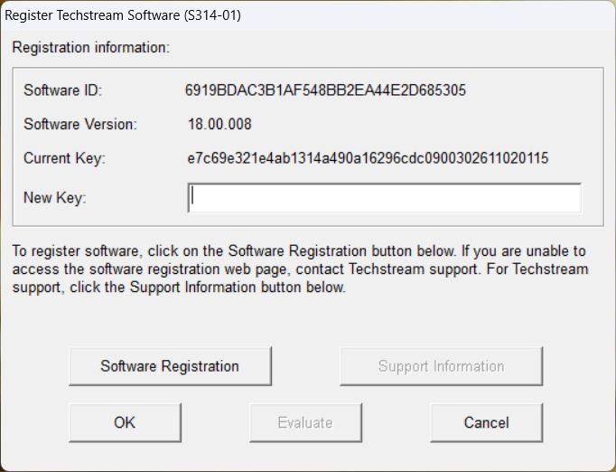

# Techstream 18.00.008 New Key 演算法分析報告

分析及實測日期：2026-11-02，Asia/Taipei。研究對象為本機已安裝的 Techstream 18.00.008，地區設定 OT。

## 1. 結果與實測金鑰

已透過 Ghidra 反編譯找出兩階段 MD5、地區參數解碼、46 字元欄位配置與時間欄位解析流程。Python 重建值與本機 x86 DLL 比對全部一致，並已在本機註冊畫面完成提交測試。

本次 Software ID：`6919BDAC3B1AF548BB2EA44E2D685305`。

```text
Software version: 18.00.008
Region: OT
Days: 0030
Time field: 2611020115
New Key:
e7c69e321e4ab1314a490a16296cdc0900302611020115
```

提交後，主畫面顯示 `Subscription Expiration: 30d 00h 00m`；重新開啟註冊資訊可見同一組 Current Key。關閉並重新啟動 Techstream 後顯示 `29d 23h 58m`，確認註冊資訊已寫入並可重新載入。[E07-E09]


圖 1：本次實際 GUI 截圖。左下角顯示 30 天有效期限。

## 2. 樣本、工具與證據鏈

使用安裝目錄 `C:\Program Files (x86)\Toyota Diagnostics\Techstream\bin` 的程式進行分析。分析前複製至隔離的 `local/samples/`，對副本建立 Ghidra 專案。安裝中的三個主要二進位均與工作區既有安裝包解出副本的 SHA-256 相同；這證明本次兩份樣本一致，並非官方發行來源的額外認證。[E01]

| 檔案 | 大小 | 本次用途 |
| --- | --- | --- |
| MainMenu.exe | 2,953,216 bytes | 註冊對話框、地區參數、欄位解析與結果比較 |
| tiswebapi.dll | 565,248 bytes | 原生字串串接、MD5 與小寫十六進位輸出 |
| IT3Versatile.dll | 24,576 bytes | 地區參數的位移解碼 |

完整 SHA-256 收錄於 `evidence/static/binary-manifest.json`。三者均為本次以 x86 位址分析的 PE 檔。Ghidra 位址是靜態 image base 下的 VA；執行階段位址可能因載入位置而不同。

```text
MainMenu.exe
367454c8161def29cf2df5e619f135cfce142fbd7a004666fcc063faa228b594
tiswebapi.dll
73d8251c46fb0c9b9cac4005f257443f5574d018cb4dc4bbda486c23829e55fe
IT3Versatile.dll
8e607391cad2c199a473a17eeb3c01a4ece1fd7009d21c0b37e189a471f6436c
```

工具包括本機 Ghidra 12.1.4、JDK 21、Python，以及 Windows .NET Framework 的 x86 C# 編譯器。Python 計算器只使用標準函式庫；原生比對用獨立 x86 程序載入實際安裝 DLL。[E01, E06]

## 3. New Key 的資料配置

OT、NA、EU 使用下列 46 字元配置。索引從 0 開始；每個十六進位字元是文字，並非把整段字串先轉成二進位數值。[E02]

| 區間 | 長度 | 意義 | 本次值 |
| --- | --- | --- | --- |
| 0-31 | 32 | 第二階段 MD5 的小寫十六進位 | e7c69e321e4ab1314a490a16296cdc09 |
| 32-35 | 4 | 十進位有效天數，補前導零 | 0030 |
| 36-45 | 10 | YYMMDDHHMM 時間欄位 | 2611020115 |

`MainMenu!004218b0` 先檢查長度 `0x2e = 46`，再用 `Mid(32,4)`、`Mid(36,10)`、`Left(32)` 拆出兩個數字欄位和摘要。`004b6570` 逐字檢查數字欄位是否介於 ASCII `0` 與 `9`，然後重新計算摘要並以字串比較確認一致。[E02]

時間欄位可由 `MainMenu!0041d500` 的 `20%s01` 格式字串及 `004b6110` 日期解析器確認：`2611020115` 會變成 `20261102011501`，即 2026-11-02 01:15:01。秒固定為 01。它不是 Unix timestamp，也不是版本號。[E05]

應用程式會在特定既有註冊／覆寫分支使用此時間與舊資料比較；有效天數也參與持久化的授權時間計算。不能僅以最後 10 碼推定 GUI 顯示的到期時間。原生日期解析器的年份上界是 2037；重建計算器因此拒絕更晚的簽發年份。[E05]

## 4. 完整計算流程

令 `MD5hex(x)` 表示將 ASCII 字串 x 計算 MD5，並把 16 bytes 摘要轉成 32 字元小寫十六進位文字；`||` 表示直接串接，沒有分隔符號、換行或結尾 NUL。

```text
S = 32-character uppercase Software ID
V = text before first "." in version; "18"
D = zero-padded decimal days; "0030"
T = YYMMDDHHMM; "2611020115"
R = decoded region value; OT = "SKE48"

H1 = MD5hex(S || V)
H2 = MD5hex(H1 || R || D || T)
NewKey = H2 || D || T
```

`MainMenu!00420d80` 以 `SpanExcluding(".")` 取主要版本；先呼叫 `CWebService::TisServiceRegistration` 計算第一段，再選擇地區資料、解碼並組成第二次呼叫的字串。[E03]

本次第一階段輸入與輸出：

```text
Input1 = 6919BDAC3B1AF548BB2EA44E2D68530518
H1     = ea5463fac8b3ecd5cf627d10562b6efc
```

第二階段使用 H1 的 32 個文字字元，而不是 H1 對應的 16 個原始 bytes：

```text
Input2 = ea5463fac8b3ecd5cf627d10562b6efcSKE4800302611020115
H2     = e7c69e321e4ab1314a490a16296cdc09
NewKey = e7c69e321e4ab1314a490a16296cdc0900302611020115
```

本次 Input1 為 34 bytes，Input2 為 51 bytes。相同輸入會產生相同結果；改變 Software ID、主要版本、地區、天數或時間欄位，都會改變對應摘要。次版本在此分支被取主要版本的操作排除，但這並不代表所有其他 Techstream 版本都已驗證相容。

## 5. 地區參數如何還原

`MainMenu!004a9e40` 在特定旗標為 1 的分支，將固定文字寫入地區資料表；`00420d80` 依地區選取，並透過 `00425100` 呼叫 `IT3Versatile.dll` 的 ordinal 2。這條路徑已由交叉參照及組合語言確認。[E03-E04]

對編碼字元 c，解碼器執行以下操作。這是 `0x30..0x7a` 範圍的 75 字元位移，不是只對英文字母套用的 ROT13。

```text
x = unsigned_byte(c) - 13
if x < 0x30:
    x += 0x4b
output = x & 0xff
```

| 地區 | 編碼文字 | 解碼文字 |
| --- | --- | --- |
| OT | `XRAE，首字元為 ASCII 0x60 | SKE48 |
| NA | W:R[_BTnx;a9 | JxENR5GakyTw |
| EU | Z;]4>7Bv5`>pxEB@CB | MyPr1u5isS1ck85365 |

OT 的五個編碼 bytes 為 `60 58 52 41 45`，分別減去 `0d` 得到 `53 4b 45 34 38`，即 `SKE48`。此例沒有觸發補 75 的分支；NA、EU 的部分字元會觸發。

JP 也有專用固定資料，但第一階段會採用不同輸入，並對摘要、天數與時間重新排列。由於本次實際地區是 OT，提供的 CLI 支援 OT／NA／EU，對 JP 明確回報不支援，避免把相同長度誤當成相同演算法。

## 6. 為何能確認是 MD5

`tiswebapi!10001160` 是匯出的 C++ 包裝函式，將參數轉交 `10010480`。後者用 `%s%s` 合併前兩個字串，再初始化、更新及完成摘要，最後迴圈處理 16 bytes，以 `%02x` 輸出。雖然函式名稱帶 WebService，本次此函式的摘要路徑是本地計算。[E06]

在 `10003860` 可見初始狀態 `67452301`、`efcdab89`、`98badcfe`、`10325476`；`10003990` 可見 `0x80` 填補、補至區塊尾端長度欄位，以及以 little-endian 狀態輸出 16 bytes。`10003a50` 是區塊轉換核心。這些靜態特徵與實際 DLL 的多組輸出共同支持 MD5 判定。[E06]

從計算機制看，MD5 將輸入分成 64-byte 區塊；尾端加入 `0x80`、必要的零及原始 bit 長度，再以四個 32-bit 狀態經非線性布林函數、加法及循環位移更新，輸出 128-bit 摘要。本次兩段輸入都短於 56 bytes，分別填補後各使用一個區塊。額外測試涵蓋 55、56、64、128 bytes，以確認區塊邊界行為，而非只用本次短字串猜測演算法。

摘要在本機驗證端可重新計算，固定地區資料也位於客戶端，因此這條註冊分支可用已還原的輸入規則重建。單純存在兩次 MD5 並不構成外部私鑰簽章；本次未發現需要伺服器簽章才能完成此 OT 註冊的證據。

## 7. 反編譯判讀及原生 ABI

原始程式含 MFC CString、C++ 例外處理及析構器；部分 Ghidra 自動還原的型別與參數不完整。例如偽 C 的 `CString::Mid` 可能遺漏長度參數，帶大型 stack allocation 的函式也會出現不合理的 stack 變數。報告以呼叫前的 PUSH 順序、常數及實際輸出補強判讀，不把偽 C 的變數名稱當成原始設計名稱。

| 模組／VA | 還原出的角色 |
| --- | --- |
| MainMenu 004218b0 | 46 字元拆解、數字檢查、摘要驗證 |
| MainMenu 00420d80 | 主要版本、兩階段 MD5、地區參數 |
| MainMenu 004a9e40 | 設定地區固定文字的分支 |
| MainMenu 00425100 | 呼叫位移解碼 DLL 的包裝 |
| MainMenu 0041d500 | GUI 註冊主流程及時間／覆寫分支 |
| MainMenu 00423330 | 取天數，乘以 86400 秒 |
| MainMenu 004b6110 | YYYYMMDDHHMMSS 日期解析 |
| tiswebapi 10010480 | 串接、MD5、十六進位輸出 |
| IT3Versatile 10001790 | DecryptByRotatShiftVariable |

原生 probe 以 `/platform:x86` 編譯，透過匯出名稱查找函式，使用 `CallingConvention.ThisCall` 對應 C++ ABI。包裝函式實際使用 DLL 的全域服務實例，因此此特定匯出可傳入零 instance。這一點由包裝函式的組合語言確認，不能泛化到任意 C++ 成員函式。[E06]

## 8. 本機程式庫與 Python 測試

`scripts/NativeProbe.cs` 載入安裝中的 `tiswebapi.dll`；`native_validate.py` 用它分別執行 H1 和 H2，而非拿 Python 自己的輸出再次當成唯一判定來源。完整機器可讀結果收錄於 `native-results.json`。

| 測試類型 | 數量 | 結果及判定範圍 |
| --- | --- | --- |
| DLL MD5 與區塊邊界 | 5 | 全部與 Python hashlib 一致 |
| OT／NA／EU，各 1／30／9999 天 | 9 | 兩階段 DLL 摘要全部一致 |
| 摘要竄改、不同 ID、主要版本、地區 | 4 | 原生重算摘要均不相符 |
| Python unittest | 6 | 固定向量、欄位竄改、輸入及日期邊界全部通過 |

原生比對共 18 組通過。9999 天案例只證明字串計算與摘要一致，未在 GUI 套用，也未證明此天數能跨越原生時間表示範圍。NA、EU 同樣只完成本機摘要路徑驗證。

## 9. 本機 GUI 提交與持久化驗證

1. 起始註冊畫面顯示指定 Software ID，Current Key 空白。
2. 輸入 46 個 `0` 並實際按下 OK；註冊對話框重建、New Key 清空，Current Key 仍空白。本次沒有觀察到獨立錯誤訊息框，因此只記錄未接受與清空結果。
3. 輸入本報告的 30 天金鑰，按下 OK；對話框關閉，主畫面顯示 `30d 00h 00m`。
4. 重新開啟註冊對話框，Current Key 顯示完整相同字串。
5. 安裝目錄的 `Env/IT3UserCustom.ini` 中，`Registration - OT` 的 `MhbdordJdx` 寫入相同金鑰；相關時間欄位也由程式寫入。
6. 關閉並重新啟動本機程式後顯示 `29d 23h 58m`，確認跨行程載入仍有效。



圖 2：成功提交後重新開啟註冊資訊，Current Key 與計算範例一致。


圖 3：新行程啟動後仍顯示剩餘有效期限。

實測期間 Windows 曾拒絕輸入，使用者恢復桌面後完成後續操作。關閉時 MainMenu 曾留下無視窗的背景行程，結束該行程後才重新啟動；當時另見本機 Error Report 視窗，選擇 Don't send 後關閉。這些環境事件不被計為註冊成功證據；成功判定來自期限顯示、Current Key、設定檔及新行程重新載入。

本次保留測試成功的 30 天註冊狀態。設定檔測試前備份放在 Git 忽略的 `local/backup/`；三個分析目標二進位沒有被修改。未連接車輛，未執行 ECU 操作，未以此測試推定線上服務可用。

## 10. 重跑方式及適用界線

從專案根目錄，設定 `PYTHONPATH=src` 後執行：

```powershell
python -m techstream_keys 6919BDAC3B1AF548BB2EA44E2D685305 --days 30 --issued 2611020115
python -m unittest discover -s tests -v
```

完整 Ghidra 與 Windows 原生重跑命令見 `docs/reproduction.md`。`examples/reference-vector.json` 保存每個中間字串；反編譯輸出及組合語言保存在 `evidence/static/`。計算器接受大小寫 Software ID 後統一轉成畫面顯示的大寫；原生 MD5 函式本身對字元大小寫敏感。

GUI 測試結果僅涵蓋本次 ID、18.00.008、OT、30 天及當時本機狀態。未完整測試既有授權覆寫、時鐘變更、過期後行為、其他硬體 ID、所有版本或 JP。此報告從已顯示的 Software ID 開始分析，不包含硬體資訊如何產生 Software ID 的完整還原。

## 11. 證據索引

| 代號 | 專案內位置 |
| --- | --- |
| E01 | evidence/static/binary-manifest.json |
| E02 | evidence/static/MainMenu/004218b0.c 及 .asm.txt |
| E03 | evidence/static/MainMenu/00420d80、004a9e40、00425100 |
| E04 | evidence/static/IT3Versatile/10001790.c 及 .asm.txt |
| E05 | evidence/static/MainMenu/date-flow.asm.txt、004b6110、00423330 |
| E06 | evidence/static/tiswebapi/，scripts/NativeProbe.cs |
| E07 | evidence/runtime/gui-success.jpg 及 .txt |
| E08 | evidence/runtime/gui-current-key.jpg 及 .txt |
| E09 | evidence/runtime/gui-restarted-0.jpg 及 gui-restarted.txt |
| E10 | evidence/runtime/native-results.json、unit-tests.txt、gui-results.json |

證據來源是本次本機檔案、反編譯輸出與實測，不依賴網路上第三方金鑰產生器或未驗證的公式。
